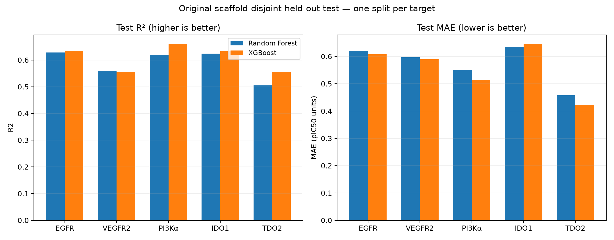
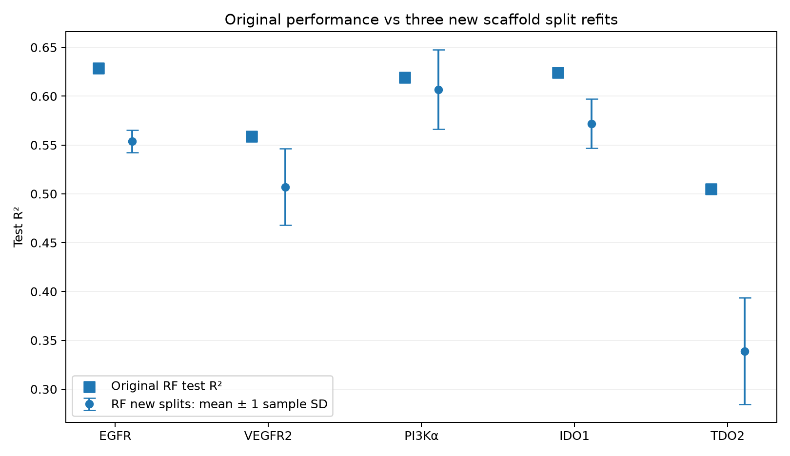
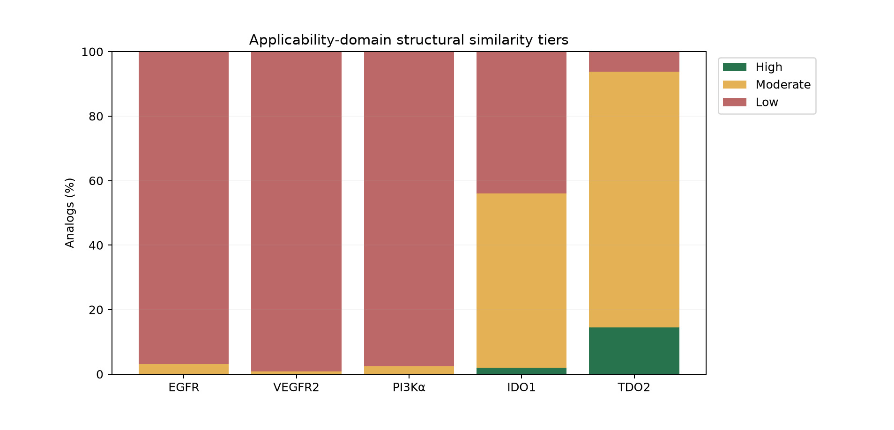

# ML Screening and Validation — Final ML Evaluation and Integration Report

Generated (UTC): 2026-11-15T15:50:57.874059+00:00
**Project:** Tryptanthrin analog anticancer target-wise bioactivity screening
**Scope:** Five modelled targets (EGFR, VEGFR2, PI3Kα, IDO1, TDO2). The original six-target plan requires team confirmation.

## 1. Role and objectives

ML Screening and Validation developed target-specific ECFP4/Morgan fingerprint features, trained Random Forest and XGBoost pIC50 regression models, evaluated scaffold-disjoint test performance, audited fingerprints and train/test leakage, measured analog structural applicability, and integrated in-silico candidate predictions.

## 2. Data and modelling approach

- Input labels are target-specific curated median **pIC50** from exact IC50 measurements (ChEMBL); they are **not** binary active/inactive classifications. BindingDB source data were not automatically merged into the trained datasets.
- Features: RDKit Morgan radius 2 (ECFP4-like), 2048-bit folded fingerprints; chirality not explicitly encoded.
- Train/validation/test: two-stage Bemis–Murcko scaffold GroupShuffleSplit, random seed 42 for original models; observed molecule proportions depend on scaffold group sizes.
- Random Forest: 200 estimators, min_samples_leaf=2, max_features=sqrt, random_state=42. XGBoost: histogram tree method with validation-based early stopping.
- Evaluation: MAE, RMSE and R² on a fixed scaffold-held-out test partition, plus training-median baseline. Higher pIC50 corresponds to lower IC50 within the defined endpoint, but cross-assay comparability has not been established.

## 3. Original held-out test performance

| Target | Test n | RF MAE | RF RMSE | RF R² | XGB MAE | XGB RMSE | XGB R² |
|---|---:|---:|---:|---:|---:|---:|---:|
| EGFR | 1282 | 0.6192 | 0.8082 | 0.6287 | 0.6083 | 0.8025 | 0.6339 |
| VEGFR2 | 1254 | 0.5964 | 0.7620 | 0.5590 | 0.5890 | 0.7645 | 0.5562 |
| PI3Kα | 970 | 0.5491 | 0.7223 | 0.6191 | 0.5135 | 0.6814 | 0.6610 |
| IDO1 | 435 | 0.6341 | 0.8244 | 0.6244 | 0.6464 | 0.8154 | 0.6326 |
| TDO2 | 164 | 0.4576 | 0.6080 | 0.5051 | 0.4237 | 0.5755 | 0.5565 |

**Interpretation:** Test performance is preliminary and represents one scaffold split per target. Differences between RF and XGBoost do not establish a universally superior algorithm. Do not repeatedly use the original test set for hyperparameter tuning.

## 4. Data integrity and fingerprint leakage audit

| Target | Training | Test | Shared train/test scaffolds | Shared exact structures | Shared fingerprints |
|---|---:|---:|---:|---:|---:|
| EGFR | 7602 | 1282 | 0 | 0 | 38 |
| VEGFR2 | 6917 | 1254 | 0 | 0 | 16 |
| PI3Kα | 4489 | 970 | 0 | 0 | 22 |
| IDO1 | 2761 | 435 | 0 | 0 | 16 |
| TDO2 | 663 | 164 | 0 | 0 | 1 |

Distinct structures can produce identical 2048-bit Morgan fingerprints, including stereochemical differences or folding collisions. This is representation-level overlap, not proof of exact-molecule duplication. Chemical standardization for salt/tautomer equivalence remains incomplete.

## 5. Fingerprint collision sensitivity

The existing test predictions were re-evaluated after excluding test molecules whose fingerprints matched training fingerprints. The analysis did not retrain models. Results are descriptive and cannot replace independently designed validation.

Source: `reports/final_validation/fingerprint_collision_sensitivity_metrics.csv`.

### Numerical sensitivity results (saved Step 12 predictions)

| Target | Affected test molecules | RF full R² | RF excluded R² | XGB full R² | XGB excluded R² |
|---|---:|---:|---:|---:|---:|
| EGFR | 38 (2.96%) | 0.6287 | 0.6289 | 0.6339 | 0.6354 |
| VEGFR2 | 17 (1.36%) | 0.5590 | 0.5576 | 0.5562 | 0.5545 |
| PI3Kα | 24 (2.47%) | 0.6191 | 0.6152 | 0.6610 | 0.6569 |
| IDO1 | 17 (3.91%) | 0.6244 | 0.6283 | 0.6326 | 0.6379 |
| TDO2 | 2 (1.22%) | 0.5051 | 0.5054 | 0.5565 | 0.5554 |

Largest absolute change in R² after excluding matching-fingerprint test molecules: **0.0054**.
The excluded subset differs in composition from the original test set; changes in R² do not directly quantify leakage-induced bias.
This is a descriptive fixed-model sensitivity analysis, not independent prospective validation.

## 6. Repeated scaffold-split robustness — Random Forest only

Three new scaffold-disjoint splits (seeds 13, 23, 37) were each used to refit the baseline RF configuration. Variability reflects changed held-out scaffolds and activity distributions. **No analogous XGBoost repeated-split experiment was performed.**

| Target | Original RF R² | RF repeat mean R² | Sample SD | Range |
|---|---:|---:|---:|---:|
| EGFR | 0.6287 | 0.5538 | 0.0113 | 0.5450–0.5666 |
| VEGFR2 | 0.5590 | 0.5070 | 0.0391 | 0.4719–0.5491 |
| PI3Kα | 0.6191 | 0.6069 | 0.0408 | 0.5598–0.6308 |
| IDO1 | 0.6244 | 0.5720 | 0.0253 | 0.5435–0.5919 |
| TDO2 | 0.5051 | 0.3389 | 0.0546 | 0.2980–0.4009 |

**TDO2 caveat:** Its relatively small dataset and lower repeated RF performance warrant particular caution, even if generated analogs are often structurally similar to TDO2 training compounds.

## 7. Applicability and compound predictions

- The filtered generated library has 11,355 analogs. Predictions were generated for all five targets, yielding 56,775 target–analog rows. Both RF and XGBoost provide predictions; their agreement is not a calibrated uncertainty estimate.
- Training-only nearest-neighbor Morgan Tanimoto is used as an exploratory structural applicability indicator. Similarity thresholds are heuristic, not validated confidence bounds.
- EGFR, VEGFR2 and PI3Kα generated analog predictions mostly fall in the low-similarity category; IDO1 and TDO2 have better structural coverage. Better coverage does not establish experimental efficacy or robust model extrapolation.

## 8. Integrated diversity shortlist

- 50 target–analog shortlist entries correspond to 49 distinct Analog IDs. This is a computational docking handover, **not** a set of experimentally validated hits.
- Ranking considers predicted activity, RF/XGB disagreement, applicability tier, drug-likeness and synthetic accessibility; within-target diversity uses pairwise fingerprint Tanimoto ≤ 0.75.
- Chemically diverse selection was restricted to the top 500 eligible rows for IDO1 and TDO2; the final candidate list is dependent on this pre-ranking.
- Parent triptanthrin comparison is structural unless parent predicted pIC50 and relevant assay context are separately verified.

| Target | Selected | Maximum pairwise selected Tanimoto |
|---|---:|---:|
| EGFR | 10 | 0.7419 |
| VEGFR2 | 10 | 0.7407 |
| PI3Kα | 10 | 0.7455 |
| IDO1 | 10 | 0.7447 |
| TDO2 | 10 | 0.7333 |

## 9. Methodological limitations and project decisions

- No direct in-vitro target inhibition, cellular anticancer activity or external prospective validation is established by these predictions.
- Exact ChEMBL endpoint curation and median label construction are inherited from Member 4. Mixed assay conditions, biological heterogeneity, potential stereochemical conflation, salt/tautomer standardization and outlier records require documented review.
- Scaffold isolation reduces one form of leakage; distinct structures with equal fingerprints remain possible; overlap sensitivity was assessed separately.
- Three repeated RF splits are insufficient to calculate a calibrated generalization confidence interval. The original and repeated results should both be shown.
- Since pIC50 is continuous, classification class-imbalance metrics do not directly apply; examine underrepresented extremes in the response distribution.
- Candidate similarity tiers and RF/XGB model agreement are prioritization heuristics, not calibrated probability or prediction intervals.
- Target selectivity cannot be inferred solely by ranking pIC50 from heterogeneous target-specific datasets; harmonized experimental validation is necessary.
- A sixth target was described in the original team work division but is not included in the current five-target modelling workflow: document the agreed scope.

## 10. Reproducibility and handover checklist

1. Preserve original `data/raw/` target datasets and filtered analog library, along with Member 4/Member 3 version details.
2. Preserve scripts `01`–`09` and `11`–`14`, saved model artifacts and environment package versions.
3. Store `reports/all_targets_model_comparison.csv`, Step 11/12 audit tables, Step 13 repeat-split results and Step 6 applicability results.
4. Share `reports/diversity_shortlist/master_docking_handover.csv` and the independently audited handover with the docking team; verify unique structures and parent/reference identities.
5. Ensure figures include captions stating that all activity results are model-derived estimates; do not call candidates confirmed inhibitors.
6. Open `notebooks/Member5_results_review.ipynb` to inspect final outputs without retraining models.

## Source files (relative to project root)

- `reports\all_targets_model_comparison.csv` (available)
- `reports\final_validation\leakage_and_dataset_audit.csv` (available)
- `reports\final_validation\fingerprint_collision_sensitivity_metrics.csv` (available)
- `reports\final_validation\repeated_scaffold_robustness\rf_robustness_summary.csv` (available)
- `reports\applicability_domain\similarity_summary.csv` (available)
- `reports\analog_predictions\prediction_summary.csv` (available)
- `reports\candidate_prioritization\screening_summary.csv` (available)
- `reports\diversity_shortlist\diversity_summary.csv` (available)
- `reports\diversity_shortlist\master_docking_handover.csv` (available)

## 11. Submission verification and pending decisions

- The final report was assembled from previously saved outputs; no models were retrained.
- **Team decision pending:** confirm whether the sixth proposed target was formally excluded.
- **Scientific review pending:** confirm published-reference identities and parent-compound activity comparisons.
- **Notebook:** confirm review cells execute with the project virtual environment.
- **Reproducibility:** preserve requirements, source data versions, model files and processing scripts.
- **Uncertainty:** no calibrated confidence intervals or external experimental validation are claimed.
